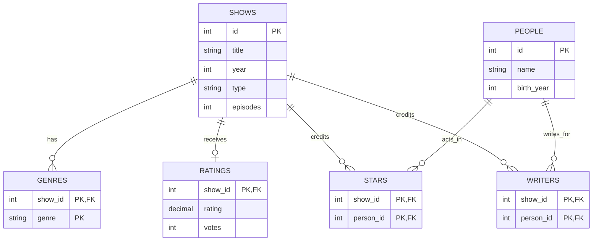

# TV Show Catalog ERD

| Table | What one row represents |
| --- | --- |
| `SHOWS` | One show, with its title, release year, type, and episode count. |
| `PEOPLE` | One person who can be credited as a star, a writer, or both. |
| `GENRES` | One genre attached to one show. |
| `RATINGS` | One show's average rating and total vote count. |
| `STARS` | One person credited as a star on one show. |
| `WRITERS` | One person credited as a writer on one show. |

## Design assumptions

- Shows can share a title, so each show has its own ID. The `episodes` field stores the number of episodes for the show.
- A show can have zero or more genre labels, stars, or writers. A person can have credits on several shows and can appear in both credit tables.
- A show can have zero or one rating summary. Its show ID is the primary key of `RATINGS`, which allows at most one summary per show.
- Where two columns are marked `PK`, they form one combined key. This keeps the same genre or the same person in a given credit role from appearing twice for one show.

[Course TV show catalog exercise](https://oim7510.github.io/slides/2026-11-03/#/19)
