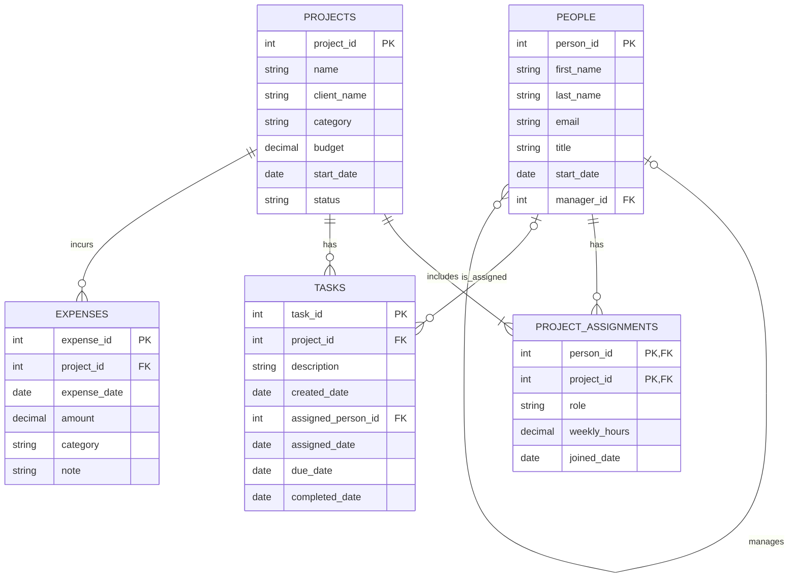

# BabsonAI Labs Database

## 1. The Scenario
Scenario A: BabsonAI Labs, a startup founded by Babson students that builds AI tools for small businesses. It has about 25 employees and currently tracks its work in spreadsheets and chat threads.
The database will connect people, projects, project assignments, tasks, and expenses. It will help the founders understand project spending, overdue work, and employee workloads.

## 2. The ERD

This design connects the five tables needed for Scenario A.

How to read the diagram:

- `PK` = primary key: the identifier that makes a row unique.
- `FK` = foreign key: a value that points to a row in another table, or in the same table for a manager.
- `||` = exactly one, `|o` means zero or one, `o{` means zero or many, and `|{` means one or many.
- The two primary-key columns in `PROJECT_ASSIGNMENTS` form one combined key: a person can appear only once for a particular project.

The `weekly_hours` column uses a decimal number so commitments such as 2.5 hours are allowed. Each commitment must still be between 1 and 40 hours per week.

Connections to check:

- Each person has zero or one manager; a manager can supervise many people. The founders have no manager.
- A person can have no project assignments or several. Each project has one or more assignments, and each assignment connects exactly one person to exactly one project.
- A project can have no tasks or many tasks; each task belongs to exactly one project.
- A task has zero or one assignee; a person can have no tasks or many tasks.
- A project can have no expenses or many expenses; each expense belongs to exactly one project.

An internal project's `client_name` is `NULL`, meaning it has no client name. Reports can display "Internal" for these projects.

A task can exist before anyone is assigned to it. Its `assigned_person_id` and `assigned_date` are both `NULL` until it is assigned.

The `assigned_date` column records when a task was assigned, so we can check that the assignment didn't happen before the employee's start date. An unassigned task has neither an assignee nor an assignment date. I chose to keep this extra column after reviewing the agent's proposal.

The diagram shows relationships, but the task's foreign key to `PEOPLE` alone does not guarantee that its assignee works on its project. We will check that rule by comparing tasks with project assignments in a query.	

## 3. What One Row Means

Each sentence describes what one row represents, based on my explanations of the tables.

- **people:** One row represents one person working at BabsonAI Labs.
- **projects:** One row represents one project BabsonAI Labs has taken on for a client or for its own internal work.
- **project_assignments:** One row shows who is assigned to one particular project, with one person per row.
- **tasks:** One row represents one task required by a particular project.
- **expenses:** One row represents one expense and its cost for a particular project.

## 4. Design Choices

1. **Choosing a key:** I chose `person_id` because it is stable. An employee's email can change, but the ID stays the same.

2. **Optional relationships and values:** Not every employee needs a manager, so `manager_id` can be `NULL`; the two founders have no manager. A task can exist before anyone is assigned to it, so its assignee and assignment date can also be `NULL`. Internal projects have no client, so their `client_name` is `NULL`.

3. **Rules checked with queries:** Tasks should only be assigned to someone who works on that task's project. The link to `people` alone does not enforce that rule, so I will compare tasks with project assignments in a query and list any violations. I will also use queries to check assignment dates against employee start dates and to find any projects without project assignments.

4. **An agent proposal I changed or did not take:** The agent first proposed storing weekly hours as whole numbers. I chose to allow fractional hours, such as 2.5 hours per week, so I changed `weekly_hours` to a decimal number. The scenario limits commitments to between 1 and 40 hours but does not require whole hours.
